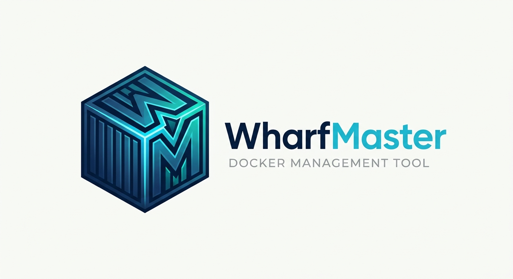
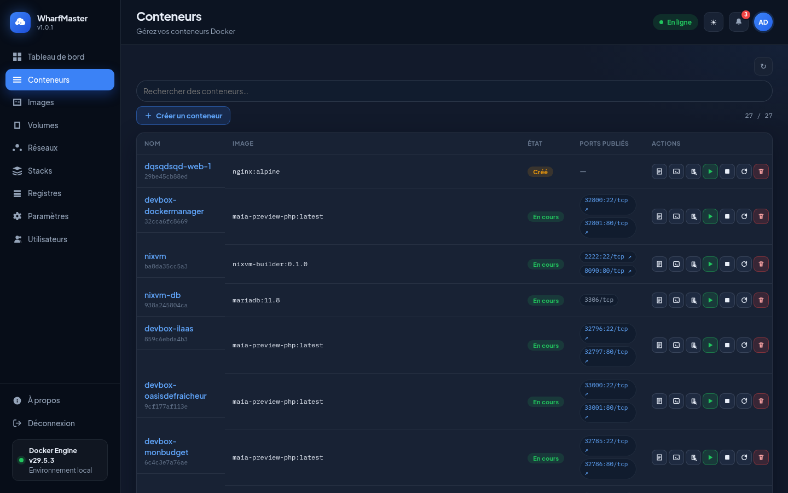
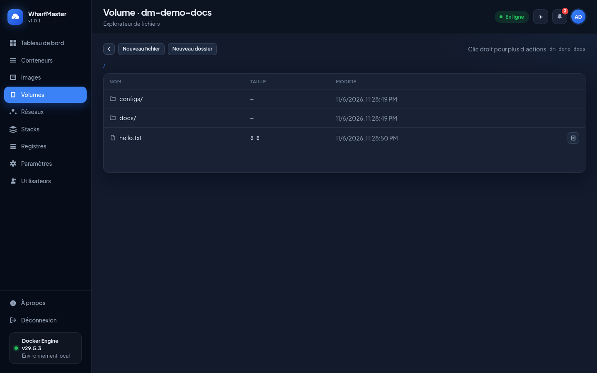
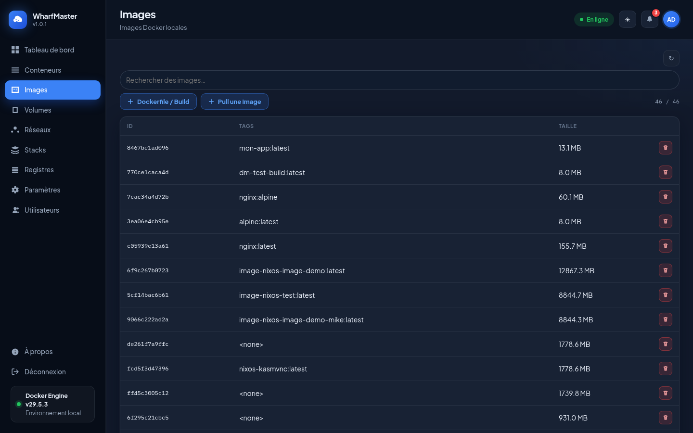
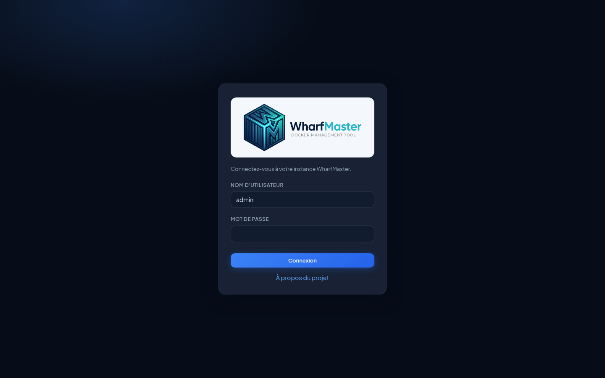
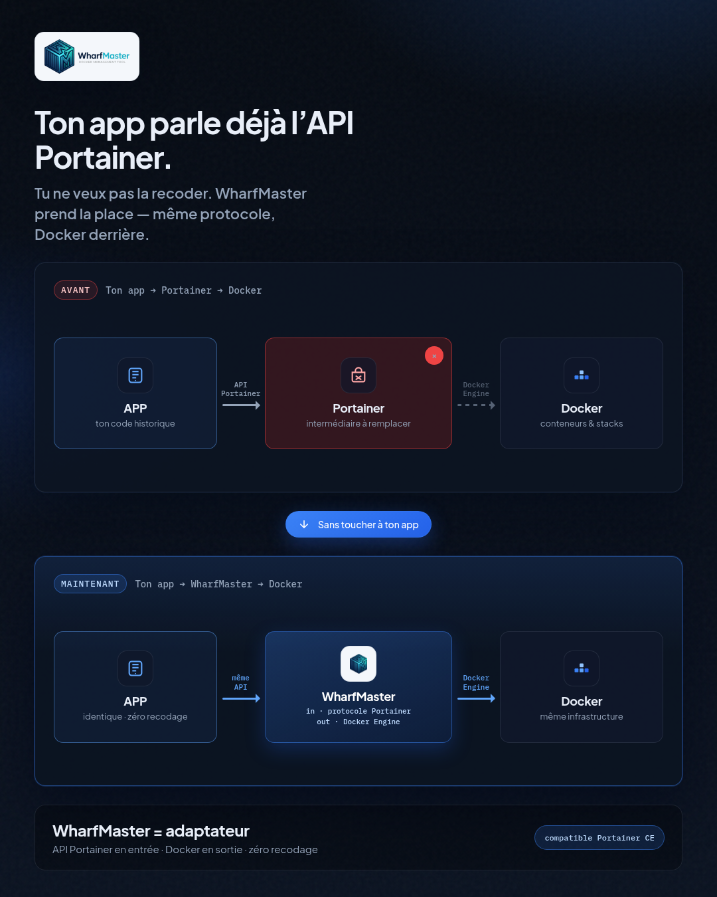

# WharfMaster

**WharfMaster** est une interface web de gestion Docker : conteneurs, images, volumes, réseaux, stacks Compose et registres — avec **équipes**, **ACL par nœud**, **SSO Active Directory**, **scheduler**, **scan CVE Trivy**, isolation multi-utilisateurs et une API compatible Portainer CE.

| | |
|---|---|
| **Version** | 2.0.0 |
| **Console** | `/app` |
| **Site public** | `/` |
| **API** | `/api` |
| **Dépôt** | https://github.com/mike37510/WharfMaster |

<p align="center">
  
</p>

## Captures d’écran

### Tableau de bord


### Conteneurs



### Explorateur de volumes



### Images



### Connexion



---

## Fonctionnalités

- **Tableau de bord** — stats, conteneurs, ressources hôte (CPU / RAM / disque), activité ; vue **Tous les nœuds** agrégée
- **Conteneurs** — création, start / stop / restart, logs (suivi live, recherche, export), console, inspect
- **Images** — recherche locale + Docker Hub, pull, build Dockerfile, **pastilles CVE** (Trivy)
- **Volumes** — création, explorateur de fichiers (créer / renommer / supprimer au clic droit)
- **Réseaux & stacks Compose** — éditeur YAML, variables `.env`, pull forcé, indicateur d’images à jour, déploiement local **et sur agents**
- **Registres** — Docker Hub / Registry V2, parcours dépôts & tags, pull
- **Utilisateurs** — rôles admin / utilisateur, isolation par labels `dockermanager.owner*`
- **Équipes** — CRUD, recherche, ajout / retrait de membres, mapping groupe AD (Paramètres → Équipes)
- **ACL par nœud** — droits `lecture` / `opération` / `admin nœud` pour un **user** ou une **équipe** (Paramètres → Nœuds → Accès)
- **SSO Active Directory / LDAP** — host, TLS/LDAPS, bind, filtre ; provision users + sync groupes → équipes (Paramètres → Authentification)
- **Scheduler** — cron start / stop / restart **par stack** (détail stack → Planifications) + sidecar Compose
- **Scan CVE Trivy** — scan manuel, avis non bloquant à la création conteneur / stack, interrupteur global (Paramètres → Général)
- **Paramètres** — sous-menus : Général, Authentification, Registres, Nœuds, Utilisateurs, Équipes ; backup ZIP
- **Journaux** — audit applicatif (connexions, actions Docker / stacks / utilisateurs)
- **Nœuds (multinode)** — agents HTTPS, modal d’ajout, édition (nom / URL), ping, activer / désactiver, délier, TLS pin
- **Sécurité** — rate-limit login, politique Compose résolue (`docker compose config`), proxy Docker restreint pour les non-admins
- **API** — compatible **Portainer CE** (teams, memberships, policies, LDAPSettings…) + extensions WharfMaster (`/api/acls`, `/api/schedules`, scans Trivy)

### Équipes & droits d’accès (2.0)

1. Créer des **équipes** et y ajouter des utilisateurs (Paramètres → Équipes).
2. Sur chaque **nœud**, icône **Accès** : rechercher un user ou une équipe → attribuer `lecture` / `opération` / `admin nœud`.
3. Les admins globaux passent toujours ; sans ACL explicite, les users non-admin conservent le défaut **opération**.

### Scheduler (2.0)

- Ouvrir une **stack** → section **Planifications** → *Nouvelle planification* (expression cron + action).
- Le service Compose `scheduler` appelle périodiquement `POST /api/schedules/run-due` (clé API provisionnée automatiquement).

### Scan CVE Trivy (2.0)

- Activer / couper dans **Paramètres → Général**.
- Pastilles sur **Images** + scan à la demande.
- À la création d’un conteneur ou au déploiement d’une stack : contrôle soft (`/images/advise`) — **jamais bloquant** si Trivy est KO.

---

## Multinode (agents)

Le serveur principal génère un **token de jointure**. Sur chaque hôte Docker distant, une commande installe un **agent HTTPS** (certificat autosigné) ; le principal proxyfie l’API Docker via cet agent. Le certificat est renouvelé automatiquement ~30 jours avant expiration ; la page **Nœuds** affiche la date de renouvellement / expiration TLS.

Les **stacks Compose** peuvent être déployées sur un nœud agent : le principal valide le YAML (`ComposePolicy` + `docker compose config`) et conserve un miroir local pour l’éditeur ; l’agent exécute `docker compose up/down` sur le socket Docker du nœud. Les projets sont stockés sur l’hôte agent sous `/var/lib/wharfmaster/stacks` (monté dans l’agent en `/data/stacks`).

### Enrôler un nœud

1. Console → **Paramètres → Nœuds** (admin) → **Ajouter un nœud** → IP + nom → **Générer la commande**
2. Copier-coller la commande sur la machine distante (Docker + curl). L’URL `--url` reprend l’**URL publique** configurée dans Paramètres. **`--advertise` doit être en `https://`**.

Exemple (valeurs déjà remplies par l’UI) :

```bash
curl -fsSL https://VOTRE-SERVEUR/public/agent/install.sh | sh -s -- \
  --url https://VOTRE-SERVEUR \
  --token wmj_... \
  --advertise https://192.168.1.5:9001 \
  --name node5
```

Optionnel : `--stacks-dir /chemin` (défaut `/var/lib/wharfmaster/stacks`).

3. Dans la console, choisir le nœud via le sélecteur en haut à droite — ou **Tous les nœuds** pour le dashboard / listes agrégés (lecture seule ; create/update/delete stack et actions Docker demandent un nœud précis).

Le nœud local ne peut pas être délié. Relancer `install.sh` sur le même advertise **rejoint** le nœud (nouveau secret) et met à jour l’image agent (Compose inclus). Les échanges HTTP non chiffrés vers l’agent sont refusés à la jointure.

Fichiers agent : [`agent/`](agent/), script public : [`public/agent/install.sh`](public/agent/install.sh).

---

## Prérequis

**Install Docker (recommandé)** — uniquement :
- Docker Engine + plugin Compose (`docker compose version`)
- Accès au socket `/var/run/docker.sock`

**Install Apache sur l’hôte** — alternativement :
- PHP 8.2+ + Apache (`mod_rewrite`, `AllowOverride All`)
- Socket Docker + binaires `docker` / `docker compose`
- Droits d’écriture sur `data/`

---

## Installation

### Option A — Docker Compose (recommandé)

Sur une machine avec Docker et un accès Internet **pour le premier build** (image de base + paquets). Ensuite l’application tourne **en local** : code dans l’image, données dans un volume, API Docker via le socket hôte — **pas de re-téléchargement permanent**.

```bash
git clone https://github.com/mike37510/WharfMaster.git
cd WharfMaster

# Optionnel : personnaliser le port / le GID
cp .env.example .env
# Éditer .env si besoin (WHARFMASTER_PORT, DOCKER_GID)

# GID du groupe propriétaire du socket (obligatoire pour parler à Docker)
export DOCKER_GID=$(stat -c '%g' /var/run/docker.sock 2>/dev/null || echo 999)

docker compose up -d --build
```

Ouvrir **http://localhost:9000/app** (ou `WHARFMASTER_PORT`) → créer le compte **administrateur**.

| Fichier | Rôle |
|---------|------|
| [`Dockerfile`](Dockerfile) | Image Apache + PHP 8.3 + Docker CLI / Compose |
| [`docker-compose.yml`](docker-compose.yml) | Port `9000`, volume données, socket Docker, service **scheduler** |
| [`.env.example`](.env.example) | `WHARFMASTER_PORT`, `DOCKER_GID`, `DOCKER_SOCK_PATH` |
| [`deploy/docker-entrypoint.sh`](deploy/docker-entrypoint.sh) | Prépare `data/` + droits socket |

**Où sont les données ?** volume Docker nommé `wharfmaster-data` → SQLite, stacks Compose, Dockerfiles, secret JWT.  
**Backup :** Paramètres (admin) → *Télécharger le backup complet*, ou `GET /api/backup`.

```bash
docker compose logs -f          # logs
docker compose ps               # statut
docker compose pull             # (si image registry un jour)
docker compose up -d --build    # rebuild après git pull
docker compose down             # stop (conserve les données)
docker compose down -v          # stop + SUPPRIME le volume data
```

**HTTPS / domaine (ex. `dock.exemple.fr`)** : reverse-proxy (Caddy, Traefik, nginx) vers `http://127.0.0.1:9000` — ne pointez pas le domaine vers un Apache hôte vide.

**Dépannage Docker offline dans l’UI :**
```bash
stat -c '%g' /var/run/docker.sock   # → mettre la même valeur dans DOCKER_GID
docker compose up -d --force-recreate
docker compose exec wharfmaster docker info
```

### Option B — Apache sur l’hôte

#### 1. Cloner le projet

```bash
git clone https://github.com/mike37510/WharfMaster.git
cd WharfMaster
```

#### 2. Déployer sous Apache

**Important :** le `DocumentRoot` doit être la **racine du dépôt** (là où se trouvent `api/`, `public/`, `app/`, `.htaccess`) — pas un sous-dossier, pas le parent.

Exemple (fichier prêt : [`deploy/apache-vhost.conf`](deploy/apache-vhost.conf)) :

```bash
sudo git clone https://github.com/mike37510/WharfMaster.git /var/www/wharfmaster
sudo cp /var/www/wharfmaster/deploy/apache-vhost.conf /etc/apache2/sites-available/wharfmaster.conf
# Éditer ServerName + DocumentRoot si besoin
sudo a2enmod rewrite headers
sudo a2ensite wharfmaster
sudo systemctl reload apache2
```

```apache
<VirtualHost *:80>
    ServerName wharfmaster.example.com
    DocumentRoot /var/www/wharfmaster

    <Directory /var/www/wharfmaster>
        AllowOverride All
        Require all granted
    </Directory>
</VirtualHost>
```

Si `https://…/app` renvoie le **404 Apache** (« The requested URL was not found ») :
1. Vérifier `DocumentRoot` → doit contenir `ls /chemin/app/index.php`
2. `sudo a2enmod rewrite && sudo systemctl reload apache2`
3. `AllowOverride All` sur ce Directory (sinon le `.htaccess` est ignoré)
4. Derrière un reverse-proxy : proxy vers le bon port (Compose = `9000` par défaut), pas un Apache vide sur le 80 hôte

#### 3. Permissions

```bash
mkdir -p data
chown -R www-data:www-data data
chmod 700 data
```

L’utilisateur Apache doit pouvoir lire/écrire le socket Docker (groupe `docker` en général).

#### 4. Ouvrir l’application

| URL | Rôle |
|-----|------|
| `http://votre-hote/` | Site public de présentation |
| `http://votre-hote/app` | Console WharfMaster |
| `http://votre-hote/api/status` | Version / InstanceID |
| `http://votre-hote/api/health` | Santé (docker, compose, `data/`) |
| `http://votre-hote/api/backup` | Backup ZIP complet admin (SQLite, Compose, Dockerfiles, JWT) |

---

## Premier démarrage / connexion

### Première installation (aucun compte)

1. Aller sur **`/app`**
2. WharfMaster détecte qu’aucun admin n’existe (`adminInit`)
3. Créer le **compte administrateur** :
   - **Nom d’utilisateur** : libre (le champ est prérempli avec `admin`)
   - **Mot de passe** : **au moins 10 caractères**, avec **au moins une lettre et un chiffre**

Il n’y a **pas** de mot de passe par défaut : vous le choisissez à l’initialisation.

### Connexions suivantes

| Champ | Valeur typique |
|-------|----------------|
| Utilisateur | celui créé à l’init (souvent `admin`) |
| Mot de passe | celui défini à l’initialisation |

> Si vous avez oublié le mot de passe admin : réinitialisez-le via la base SQLite `data/dockermanager.sqlite` (table `users`) ou recréez un environnement propre en vidant `data/` (perte des users / stacks enregistrés).

### Comptes utilisateurs

Un **admin** peut créer d’autres utilisateurs dans **Paramètres → Utilisateurs** (rôle admin ou utilisateur).  
Les non-admins ne voient que leurs ressources (labels propriétaire / stacks personnelles) et les nœuds autorisés par ACL.

SSO optionnel : **Paramètres → Authentification** (LDAP / Active Directory).

---

## Configuration

Fichier principal : [`config.php`](config.php)

| Clé | Description | Défaut |
|-----|-------------|--------|
| `docker_socket` | Socket Docker | auto (`DOCKER_SOCKET` / `.so` / `.sock`) |
| `sqlite_path` | Base SQLite | `data/dockermanager.sqlite` |
| `jwt_secret` | Secret JWT (fichier) | `data/jwt.secret` (généré auto) |
| `jwt_ttl` | Durée de session | 4 heures |
| `compose_dir` | Projets Compose | `data/compose` |
| `dockerfiles_dir` | Dockerfiles sauvés | `data/dockerfiles` |

Variables d’environnement utiles :

```bash
export DOCKER_SOCKET=/var/run/docker.sock
export DOCKER_BIN=/usr/bin/docker
export COMPOSE_BIN=/usr/local/bin/docker-compose
export DOCKER_API_VERSION=v1.45
export WM_MASTER_KEY='…'   # chiffrement registres (sinon dérivé de jwt.secret)
export WHARFMASTER_AGENT_IMAGE=ghcr.io/mike37510/wharfmaster-agent:2.0.0
```

### Backup / restauration

```bash
# Export (admin JWT)
# Backup complet (ZIP : SQLite + Compose + Dockerfiles + JWT)
curl -fsS -H "Authorization: Bearer $TOKEN" -o backup.zip https://VOTRE-SERVEUR/api/backup
# Base seule : …/api/backup?format=sqlite

# Restauration : arrêter Apache, remplacer data/dockermanager.sqlite, redémarrer
# Conserver aussi data/jwt.secret (et WM_MASTER_KEY) pour déchiffrer les registres.
```

Sources agent : éditer [`agent/`](agent/) puis `sh scripts/sync-agent.sh` avant release.

---

## Sécurité (rappel)

- **`data/`** contient JWT + SQLite → ne pas exposer (bloqué par `.htaccess` / Apache)
- En production : **HTTPS** obligatoire (HSTS activé si `HTTPS=on`)
- Agents : empreinte TLS épinglée (SHA-256) ; mismatch → refus (rejoindre le nœud)
- Mots de passe registres chiffrés at-rest (`enc:v1:…`)
- Non-admin : pas de `privileged`, bind hôte, `docker.sock`, `network/pid: host`, etc.
- Stacks non-admin validées via `docker compose config` (YAML + `.env` résolus)
- Rate-limit : 8 tentatives de login / 15 min par IP

---

## Documentation

Guide produit + **référence API** (auth JWT / clé API, Docker proxy, stacks, nœuds, registres, health, backup) :

- Fichier : [`docs/DOCUMENTATION.md`](docs/DOCUMENTATION.md)
- Console : menu **Documentation** (`/app#docs`)

---

## API compatible Portainer CE

WharfMaster expose une **API alignée sur Portainer CE** (`/api`). L’intérêt : une application qui parlait déjà à Portainer peut basculer vers WharfMaster **sans être réécrite** — même protocole en entrée, Docker Engine derrière.

<p align="center">
  
</p>

**En résumé**

| | Avant | Avec WharfMaster |
|---|---|---|
| Ton app | parle API Portainer | **identique** (zéro recodage) |
| Intermédiaire | Portainer | **WharfMaster** (adaptateur) |
| Infra | Docker | **même Docker** |

- **Entrée** : protocole / endpoints type Portainer CE  
- **Sortie** : Docker Engine (socket / API)  
- **Gain** : conserver clients, scripts et intégrations existants

### Endpoints (aperçu)

```http
GET  /api/status
GET  /api/users/admin/check
POST /api/users/admin/init
POST /api/auth
GET  /api/users/me
GET  /api/endpoints
…   /api/endpoints/1/docker/*
GET|POST /api/stacks
GET|POST /api/registries
```

Authentification : header `Authorization: Bearer <jwt>` (obtenu via `POST /api/auth`).

---

## Structure du dépôt

```
├── api/                 Front controller API PHP
├── agent/               Agent distant (Dockerfile + PHP)
├── docs/                Documentation (`DOCUMENTATION.md`) + visuels API
├── public/
│   ├── index.html       SPA console (/app)
│   ├── js/ css/         Interface
│   ├── img/             Logo WharfMaster
│   └── site/            Site public (/)
├── src/                 Code applicatif PHP
├── config.php           Configuration
├── index.php            Entrée racine
├── .htaccess            Routage + protections
├── CHANGELOG.md
└── README.md
```

Le dossier `data/` (runtime) est **ignoré par git** (secrets, base, compose déployés).

---

## Dépannage

| Problème | Piste |
|----------|--------|
| Page blanche / 404 sur `/app` | `mod_rewrite` + `AllowOverride All` |
| « Docker offline » | Socket accessible par `www-data` ? `ls -l /var/run/docker.sock` |
| Stacks Compose échouent | `docker` / `docker compose` dans le PATH Apache |
| Impossible de se connecter | Mot de passe ≥ 10 car. lettre+chiffre ; rate-limit éventuel |
| Réinit complète | Arrêter Apache, supprimer `data/`, redémarrer → nouvel admin |

---

## Licence

**MIT** — libre d’utilisation, modification et redistribution. Voir [`LICENSE`](LICENSE).
